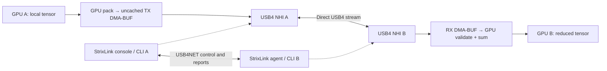

# How CiruStrixLink and the direct GPU transport work

CiruStrixLink manages the two-host USB4 connection used by a distributed
runtime. Its distinctive fast path is **message transfer through USB4 Native
Host Interface DMA rings with GPU-owned buffers**, coordinated alongside the
ordinary USB4 network. The console, kernel extension and model adapter have
separate jobs.

| Component | Responsibility | Distribution |
|---|---|---|
| `ciru-strixlink` Go binary | Discover hosts, configure USB4NET, qualify both endpoints, manage NHI lifecycle, emit runtime configuration, serve the console and optional paired GLM controls | This repository / GitHub release |
| Linux `thunderbolt-net` | IP connection for control and portable runtime traffic | Linux |
| Patched `thunderbolt_stream` | Direct stream device, ring ownership, DMA-BUF import, TX submission, completion events, RX reposting | [Qualified Linux 7.2.2 patch series](../kernel/linux-7.2.2/README.md) |
| HIP bridge + vLLM adapter | Put GPU tensors into the imported pools, exchange exact-shape partials, validate and reduce on the GPU | [GLM runtime package](https://huggingface.co/jcbtc/GLM5.3-Flash-CIRU-STRIX-IU4/tree/main/runtime) |

The Go console does not copy or proxy model tensors. Once configured, the
model adapter communicates with the stream device directly. Closing the
browser does not put tensor traffic through another route.



The reverse GPU path operates at the same time. Each rank receives the peer's
partial and calculates its own copy of the reduced tensor. The diagram
separates management traffic from the selected direct-stream data path.

## GPU allocation and exchange

The published `nhi-m8-bf16` bridge has a small C ABI accepting HIP device
pointers and the caller's stream; the bridge itself has no PyTorch dependency.
At initialization it:

1. Allocates dedicated TX and RX pools with
   `hipExtMallocWithFlags(..., hipDeviceMallocUncached)`.
2. Verifies allocation identity and exports the pools with
   `hipMemGetHandleForAddressRange(..., hipMemRangeHandleTypeDmaBufFd, 0)`.
3. Opens the discovered `/dev/tbstreamN` device and imports both file
   descriptors with `TBSTREAM_ZC_IMPORT`.
4. Enables the imported pools with `TBSTREAM_ZC_ENABLE`, maintaining persistent
   mapped control state and HIP events.

The USB4 controller transfers the contents of those GPU-owned pools. Payloads
do not pass through the TCP/IP stack or a CPU `read`/`write` payload-copy loop
on this path. There is still a **GPU pack into TX** and a **GPU read from RX
while reducing**. Here, zero-copy describes eliminating CPU payload staging;
it does not mean no copies, no CPU progress work, or a single shared allocation
spanning both machines.

This is two-sided message passing. A peer has to post receive storage and
participate in the protocol. The implementation does not expose an ibverbs
device, remote keys, one-sided reads/writes, or remote atomics.

## Exact M8 packet

The released adapter handles two-rank, contiguous **BF16 `[8,4096]`** partials:

```text
65,536 bytes of BF16 data | 32-byte owned footer
16 complete 4-KiB frames | 1 final 32-byte frame
```

The footer records protocol/dtype/rank, epoch, sequence and payload length.
The GPU writes a commit word at byte 28 last, using a system-scope release
store. The peer GPU polls it with an acquire load, checks the other fields,
and only then reads and sums the payload. The owned terminal region addresses
the observed DMA terminal-write boundary; it is part of the protocol.

Both ranks compute `BF16(float(local) + float(peer))`. The two-input BF16
gate produced maximum absolute error zero against the reference, and a
separate live comparison found bit-for-bit agreement across 102 calls / about
3.34 million BF16 elements. See [performance and evidence](performance.md).

The 4,095-frame pool uses **circular frame addressing**. Advancing a 17-frame
message modulo a rounded number of whole messages would select the wrong
storage when an exchange crosses the end of the ring. The qualified bridge
advances modulo the complete frame pool and wraps payload/footer addresses.

## Completion is more than arrival

An RX buffer may be reused only after the GPU consumer is finished and the
driver's TX/RX event accounting is consistent. The published synchronous
bridge packs, waits for pack completion, submits TX, runs GPU footer
wait/validate/sum, reaps completion events, and reposts consumed RX frames
before returning. Pools and events are persistent, but this call still has
host event/poll/ioctl work.

The separate deferred-retirement experiment left one completed-in-stream
exchange pending and retired/reposted it on the next eligible call. This
allowed more work to be enqueued after submission. It explains why a lower
standalone collective latency is only one part of model performance. The
[benchmark history](performance.md#what-translated-into-model-speed) reports
both the failed synchronous integration and the later bounded deferred gains.

Timeouts are failure deadlines, not inserted latency. For example, the model
launcher uses a 30,000-ms deadline to accommodate first-use compilation; a
successful microsecond exchange returns when complete.

## Two-sided endpoint lifecycle

The portable network must be healthy before NHI is armed. On the qualified
profile, `thunderbolt-net` retains **HopID 8** and the stream endpoints use
**HopID 9/9**, a **4,095-frame ring**, and **8,192-ns interrupt throttling**.
The tool discovers the stream service and device index instead of hardcoding
one machine's configfs service name.

```text
inspect A + inspect B → reconcile reciprocal identity and USB4NET
                              ↓
                    arm_allowed on the pair
                              ↓
                  prepare A and B concurrently
                              ↓
               inspect A + inspect B again → reconcile
                              ↓
              nhi_ready AND lease_available → launch adapter
```

One prepared host cannot establish pair readiness. Parameter disagreement,
wrong HopIDs, a missing device or partial setup requires exact cleanup before
fallback. Cleanup refuses an open device holder; it does not kill a process.
One active owner per device is the supported NHI contract.

The local patch-16 fix clears and flushes stale MSI-X status before a reused
ring is armed, addressing a reproduced first-completion failure. Kernel
version alone does not establish that the import ABI and reliability fixes
are present. [Kernel provenance and installation](../kernel/linux-7.2.2/README.md)
describe the exact validated series.

## Runtime dispatch and portable traffic

`transport env --runtime vllm` supplies transport configuration; it does not
patch a stock vLLM installation. The supplied GLM runtime contains the adapter
and exact-shape dispatch. Other collective shapes, all-gathers, and unrelated
communicators retain their existing backend. Consequently an NHI-enabled
model still uses USB4NET for control and nonmatching collective traffic.

For portable mode, generated variables pin RCCL-compatible socket traffic and
Gloo to the selected interface:

```text
NCCL_SOCKET_IFNAME==thunderbolt0
NCCL_SOCKET_FAMILY=AF_INET
GLOO_SOCKET_IFNAME=thunderbolt0
```

The first `=` separates the environment key from its value; the value itself
begins with `=` to request an exact RCCL interface match. A custom socket
runtime must use its own binding controls; these variables do not redirect
arbitrary programs. See [AMD's RCCL variable reference](https://rocm.docs.amd.com/projects/rccl/en/latest/api-reference/env-variables.html).

## Console and model lifecycle

The embedded console normally listens on `127.0.0.1:7749`; the peer agent
binds the USB4 address on TCP 7748. The test listener uses TCP 55321. Model
metrics are read from one frontend's `/v1/models` and `/metrics`, avoiding
double-counting mirrored TP ranks. The console separates live wall-time
output rate, completed-request PP/TG, and accepted/proposed draft tokens.

Optional GLM control requires fixed complementary ranks, a shared token,
loopback console, a model frontend, and scoped root-owned helpers. Load starts
rank 0 then rank 1 and verifies exact context readiness; unload reverses that
order. Failed loading runs a bounded rollback. Version 0.3.3 checks the
portable/NHI forms of this GLM deployment and leaves unrelated applications
to the operator.

## Source and release boundary

- **StrixLink:** [v0.3.3 source](https://github.com/ciru-ai/CiruStrixLink/tree/v0.3.3),
  release commit `220060a58b8164ed0676da0cda60b48759989553`.
- **Published bridge:** `nhi-m8-bf16/vllm_nhi_allreduce.cu` inside the
  [GLM kernel source archive](https://huggingface.co/jcbtc/GLM5.3-Flash-CIRU-STRIX-IU4/resolve/a1ab828d8bd5b0ba8e3281febfe3d34b12072040/runtime/packages/GLM5.3-Flash-CIRU-STRIX-IU4-kernels-source-v0.1.0-rc1.tar.gz).
  That checked archive contains the synchronous exact-M8 bridge. The
  deferred-retirement, T128 compressed pipeline and PP768 experiments are
  documented separately; they are not silently enabled by the console.
- **Kernel foundation:** the Linux USB4STREAM driver and
  [jyatesdotdev/strix-rdma](https://github.com/jyatesdotdev/strix-rdma/tree/06c1836e220dfc21becfc350e62d173861a8ac56)
  zero-copy work, rebased onto Linux 7.2.2 with Ciru's stale-MSI-X fix.
  The included patches retain their original authors and GPL-2.0 terms.
  The HIP bridge retains its MIT SPDX notice; the Go utility is Apache-2.0.

Start with [the two-host guide](getting-started.md). For another runtime,
integrate the data-plane adapter explicitly and qualify its actual tensor
shapes; portable socket compatibility alone does not enable GPU/NHI transfer.
